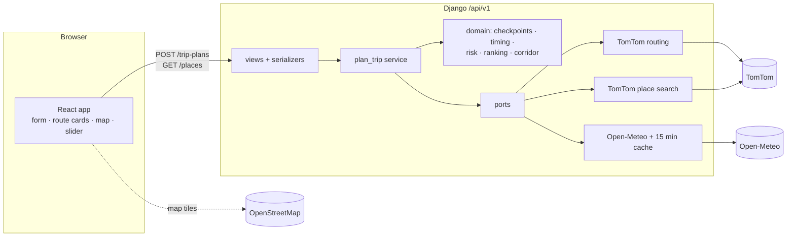

# Spotter Weather Router

Helps a truck driver pick the safest route. Enter where you're going, when you leave and your load;
the app compares up to three truck routes, checks the forecast along each one for the moment the
truck will actually be there, rates the risk with the owner's weather and load rules, and
recommends a route, with the reasons, on a map with a 0–48 hour weather heatmap.

| Path         | Stack                                                                                 |
| ------------ | ------------------------------------------------------------------------------------- |
| `backend/`   | Python 3.13, Django 6.1, Django REST Framework 3.18, httpx, uv, pytest                |
| `frontend/`  | Vite 8, React 19, TypeScript, Tailwind CSS 4, shadcn/ui, TanStack Query 5, Leaflet, Vitest |
| `artifacts/` | The owner's decision log (`REQUIREMENTS.md`) and testing notes                        |

## What it does

- **Plan a trip.** Origin and destination with place suggestions (US only), a departure from now to
  48 hours ahead in the origin's local time, and the load in pounds or kilograms (up to the
  80,000 lb federal limit). The trip lives in the URL, so a plan survives a reload, can be
  shared, and works with Back.
- **Three routes**, from TomTom's truck routing, which respects the load's weight.
- **Checkpoints** every 10, 25 or 50 miles along each route, each with its ETA and the forecast
  wind, rain and snow for that moment.
- **Risk at every checkpoint**, from Low to No Travel, with the reasons ("Wind 48 mph with a load
  over 30,000 lb"), shown on the map as hazard symbols.
- **A recommendation**: the route with the fewest severe miles, then high-risk miles, then the
  lowest average risk, then the shortest time. A route crossing No Travel conditions is never
  recommended, and the app says so when no route is safe.
- **A corridor heatmap** with a 0–48 h slider: the forecast risk along every route, hour by hour.
- **Local time everywhere.** Each ETA is shown in the time zone the truck will be in, and arrival
  in the destination's, labelled CST, MST and so on.
- **A map that reads like a map app**: a truck marks the start and a flag pin the end, hazard
  symbols mark risky checkpoints, routes are easy to pick (wide click target, hover highlight and
  tooltip), and a short animation shows what the planner is doing while it works.

## Quick start

Prerequisites: Node 24 (`nvm use 24`), [uv](https://docs.astral.sh/uv/) (it installs Python 3.13),
and a free [TomTom developer key](https://developer.tomtom.com). Open-Meteo needs no key.

```sh
cp backend/.env.example backend/.env   # set DJANGO_SECRET_KEY and TOMTOM_API_KEY
make install
make dev-backend    # API on http://localhost:8000
make dev-frontend   # app on http://localhost:5173 (proxies /api to the API)
```

`make help` lists every target. `make check` runs the full quality gate.

## How it works



The browser only talks to our API, so provider keys never leave the server. One
`POST /api/v1/trip-plans` does the whole job:

1. **Validate** the trip (departure window, origin ≠ destination, load from 1 to 80,000 lb).
2. **Route**: up to three truck routes from TomTom, departing at that time with that load.
3. **Checkpoints**: pick the spacing from the straight-line trip distance, place checkpoints along
   each route, and give each an ETA.
4. **Weather**: **one** Open-Meteo request for every distinct checkpoint, covering every ETA and
   the next 48 hours.
5. **Risk**: rate each checkpoint at its ETA, each route along its length, and recommend one.
6. **Corridor**: rate every checkpoint for each hour from now to 48 h ahead, for the heatmap.
7. **Time zones**: give each checkpoint and both ends their IANA time zone, looked up offline.

Every flow, from the system down to the rules, is drawn in
[`artifacts/DIAGRAMS.md`](artifacts/DIAGRAMS.md).

The backend keeps business rules in plain, framework-free Python (`backend/trips/domain/`).
Providers sit behind small interfaces (`trips/ports.py`), so the domain never sees a vendor's JSON
and tests use in-memory fakes. The frontend keeps logic in `src/lib/` and renders it; the backend
decides every risk level and ranking, and the UI never re-scores. `AGENTS.md`,
`backend/AGENTS.md` and `frontend/AGENTS.md` describe the structure and rules in full.

## The rules

**Risk per checkpoint** (the owner's table; every edge follows its signs):

| Condition (US units)  | Low       | Moderate  | High      | Severe    | No Travel |
| --------------------- | --------- | --------- | --------- | --------- | --------- |
| Sustained wind, mph   | < 25      | 25–34     | 35–44     | 45–54     | ≥ 55      |
| Rain + showers, in/hr | < 0.10    | 0.10–0.25 | 0.25–0.50 | 0.50–1.00 | > 1.00    |
| Snow, in/hr           | < 0.5     | 0.5–1.0   | 1.0–2.0   | 2.0–3.0   | > 3.0     |

Each level starts at its number, so 25 mph is Moderate and 0.25 in/hr is High. No Travel is
`≥ 55` for wind but `> 1.00` and `> 3.0` for rain and snow, so exactly 1.00 in/hr of rain is
Severe.

**Load rules**: 45–54 mph with a load over 30,000 lb is No Travel; 35–44 mph with a load over
40,000 lb is Severe. The load is the cargo's weight only, from 1 lb up to 80,000 lb, the US
federal gross weight limit.

A checkpoint takes its worst condition. If a reading is missing and nothing known is High or
worse, the checkpoint is **Unknown**, never Low.

**Checkpoint spacing**, by straight-line trip distance: under 150 mi every 10 mi, 150–600 mi
every 25 mi, over 600 mi every 50 mi.

**Recommendation**, in order:

1. Never a route with any No Travel miles.
2. Fewest severe miles.
3. Fewest high-risk miles (Unknown counts as High).
4. Lowest average risk, weighted by distance (Low 0, Moderate 1, High and Unknown 2, Severe 3,
   No Travel 4).
5. Shortest travel time.

Each stretch between two checkpoints takes the worse level of its two ends. Miles compare to a
tenth of a mile and the average to a hundredth, so float noise never decides. The plan says which
step decided ("Fewest miles in severe conditions").

## Decisions and assumptions

- **Weather at the truck's ETA, not now.** Wind is read at the nearest hour. Rain and snow are
  hourly totals, read for the hour the truck is in (at 10:20, the 10:00–11:00 total).
- **ETA assumes a constant average speed** along each route: departure + route duration × the
  share of the distance covered. No rest stops (the owner's "not now").
- **Departure** from now to 48 hours ahead. A departure up to 5 minutes in the past counts as now,
  since the driver's clock and ours never agree to the second.
- **US units everywhere**, in the code, on the wire and on screen. Metric is a "not now". The one
  exception is the load, which the driver may type in kilograms; the browser converts it to
  pounds before anything else sees it.
- **Local time where it happens.** The departure is typed in the origin's local time (US Central
  until an origin is picked), each ETA is shown in its checkpoint's zone and arrival in the
  destination's. The backend works in UTC; time zones come from `timezonefinder`'s offline data,
  so they cost no request, and handle Arizona's year-round standard time and Indiana correctly.
- **No Travel is never recommended.** A route with any No Travel miles is excluded; if every route
  has them, the app recommends nothing and says why.
- **Stateless.** No database, no accounts: planning is a calculation. Forecasts are cached in
  memory for 15 minutes, keyed to about 0.7 mi, to stay fast and inside Open-Meteo's free tier.
- **Providers.** TomTom for truck routing and place search; Open-Meteo for weather, because one
  request covers every checkpoint, already in mph and inches. OpenRouteService was ruled out: its
  hosted alternatives stop at 100 km.
- **The heatmap keeps exact colours.** Each corridor point is a circle in its level's colour on a
  blurred canvas pane. An additive heatmap (such as `leaflet.heat`) would let overlapping
  low-risk points add up and look riskier than they are.
- **Performance.** Route lines are simplified to within about 100 ft for the map, while
  checkpoints are placed on the full line. Responses are gzipped. The map draws on canvas, moving
  the slider makes no request and only restyles circles whose level changed, and the previous
  plan stays on screen while a new one loads.

## Known limits

- **Constant speed.** ETAs don't model slower stretches, traffic changes along the way or rest
  stops.
- **Weather is sampled, not continuous.** Between checkpoints the risk is inferred (the worse of
  both ends), and the heatmap covers the checkpoints of the three routes, not a full grid.
- **Truck restrictions use the cargo weight.** TomTom receives the load as the vehicle weight, so
  bridge and road weight limits are checked against less than the truck's gross weight.
- **Only wind, rain and snow.** Visibility, ice and temperature aren't rated.
- **Free tiers.** Open-Meteo's free API is for non-commercial use, and OpenStreetMap's tile servers
  aren't for heavy production traffic. The cache is per process and is lost on restart.
- **Not deployed yet**, and there are no accounts or trip history (both "not now").

## API

| Endpoint                           | Purpose                                                        |
| ---------------------------------- | -------------------------------------------------------------- |
| `POST /api/v1/trip-plans`          | Plan a trip: routes, checkpoints, risk, recommendation, corridor |
| `GET /api/v1/places?query=chicago` | Up to 5 US place suggestions (2+ characters), with time zones  |
| `GET /health`                      | Liveness check                                                 |

```jsonc
// POST /api/v1/trip-plans
{
  "origin": { "lat": 41.8781, "lon": -87.6298 },
  "destination": { "lat": 39.7392, "lon": -104.9903 },
  "departure_at": "2026-11-15T14:00:00Z",
  "load_weight_lb": 30000
}
// 200 → { departure_at, spacing_mi, routes[], recommendation, corridor,
//          origin_time_zone, destination_time_zone }
//   route: { id, distance_mi, duration_s, arrival_at, polyline[], checkpoints[], risk }
//   checkpoint: { coordinate, mile_marker_mi, eta, weather, risk: { level, hazards[] }, time_zone }
// 400 names the field: { "load_weight_lb": ["Load weight can be at most 80,000 lb, the federal limit."] }
// 404 no truck route · 502 a provider sent something unreadable · 503 a provider isn't responding
```

## Quality

Built test-first (red, green, refactor), one reviewed step at a time.

```sh
make test    # fast feedback, both apps
make check   # lint, formatting, strict types, and tests with a 90% coverage gate
```

- **Backend**: 274 tests, 100% line and branch coverage, Ruff, mypy strict. Every edge in the risk
  table has its own test. Provider adapters are tested against hand-written stubs of each
  vendor's documented responses, through `httpx.MockTransport`; no test touches the network.
- **Frontend**: 217 tests, 100% coverage, ESLint, Prettier, TypeScript strict. Tests drive the UI
  as a user would (roles, labels, keyboard).
- **CI** runs `make check` on every push to `main` and every pull request.

A walkthrough script for a demo recording is in [`docs/walkthrough.md`](docs/walkthrough.md).
