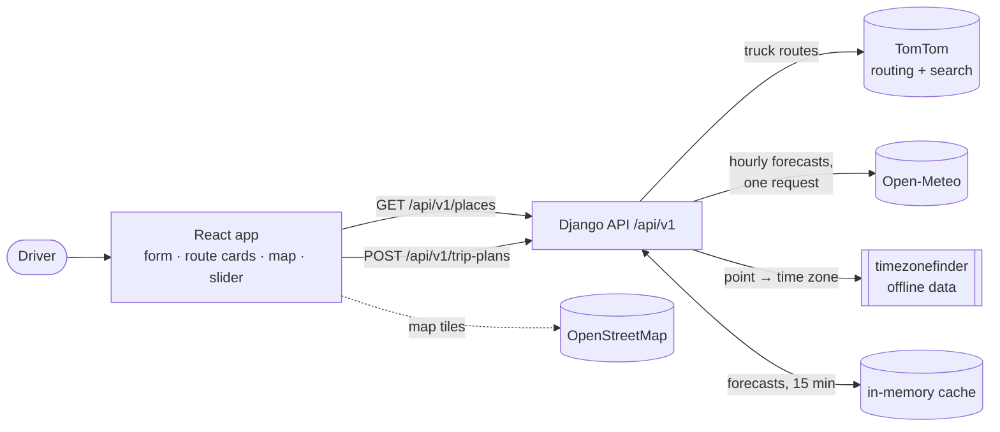
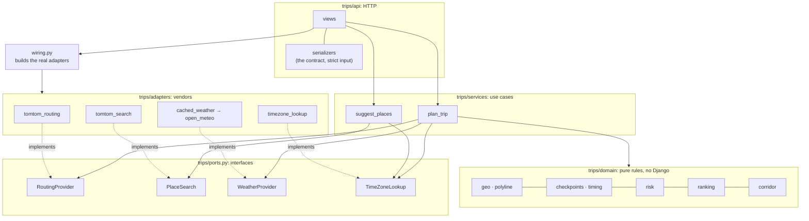
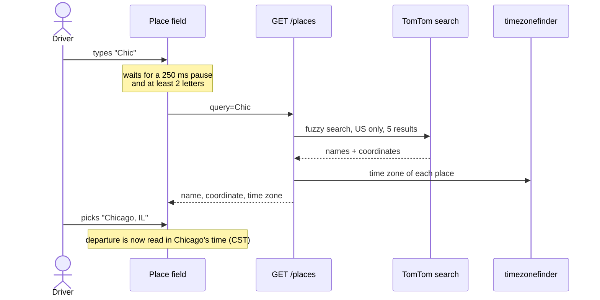
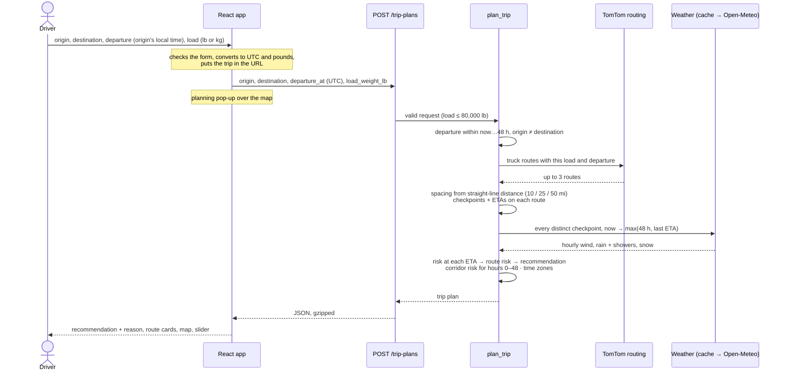
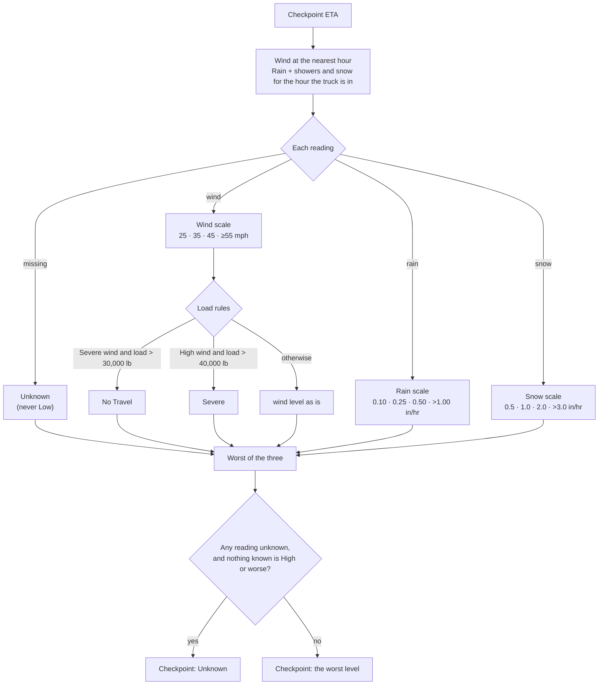
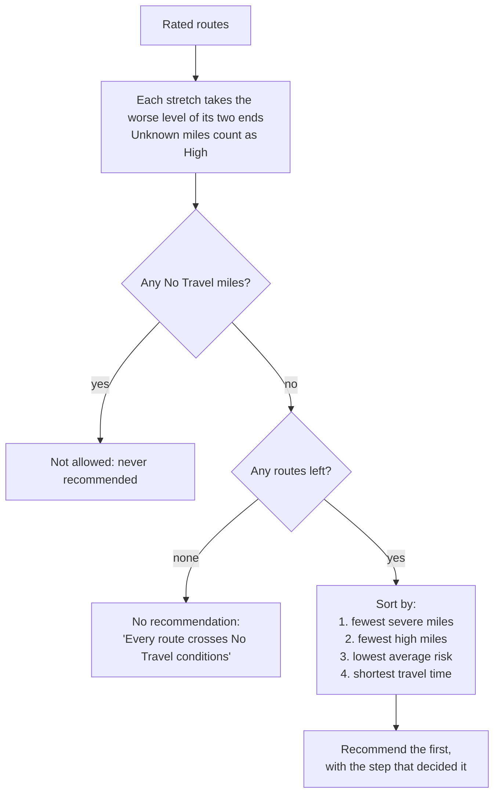
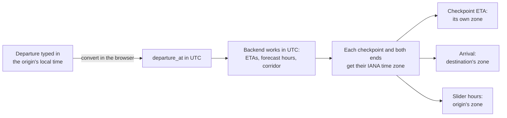
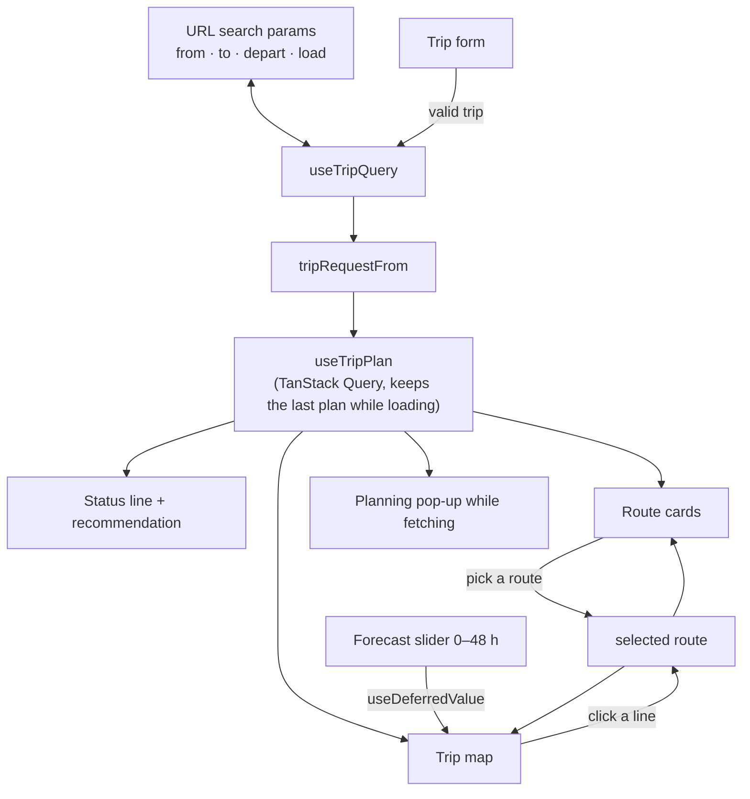

# Flow diagrams

Mermaid diagrams of how Spotter Weather Router works, from the system down to the rules. GitHub
renders them.

## 1. The system

The browser only talks to our API, so provider keys never leave the server. Time zones are looked
up offline.

## 2. Backend layers

Business rules live in plain Python. Providers sit behind small interfaces, so tests use fakes and
a vendor can be swapped by writing one adapter.

## 3. Picking a place

## 4. Planning a trip

One request does the whole job, with one weather call.

## 5. Rating a checkpoint

## 6. Recommending a route

## 7. Times and time zones

Every time is shown in the local time where it happens.

## 8. Frontend data flow

